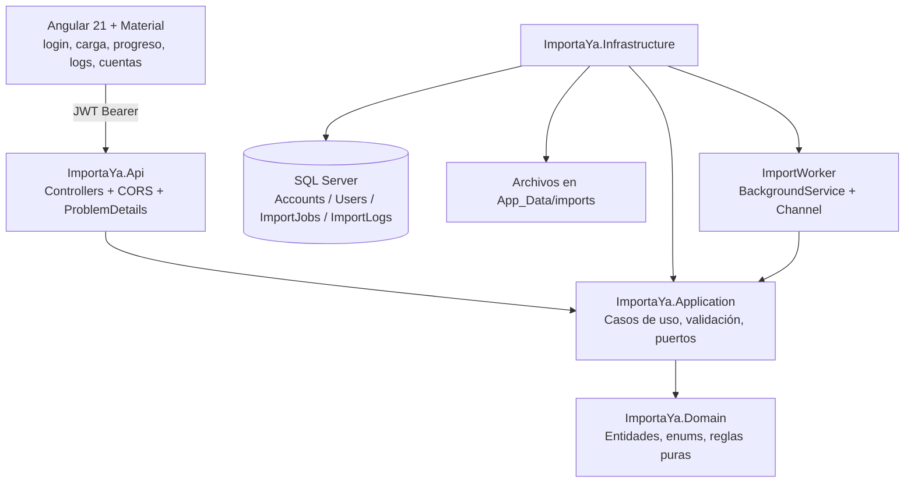
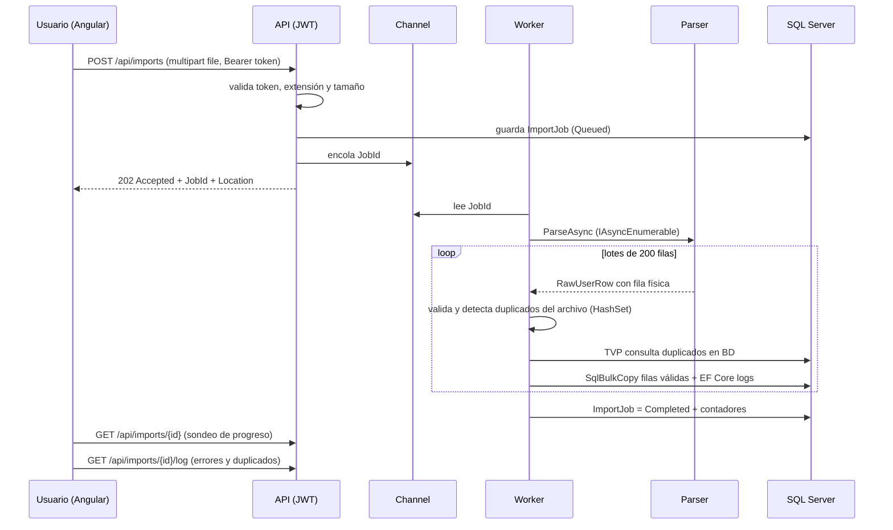
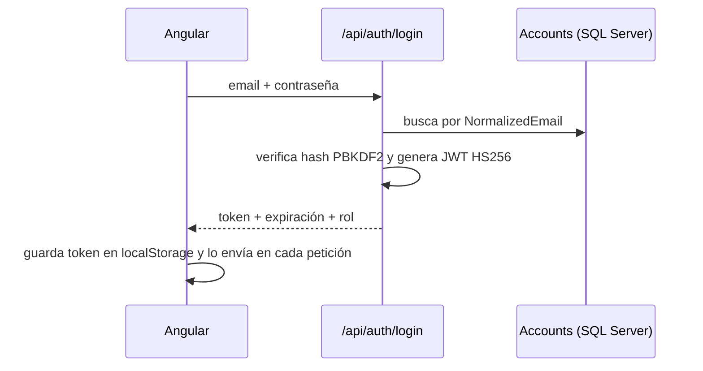
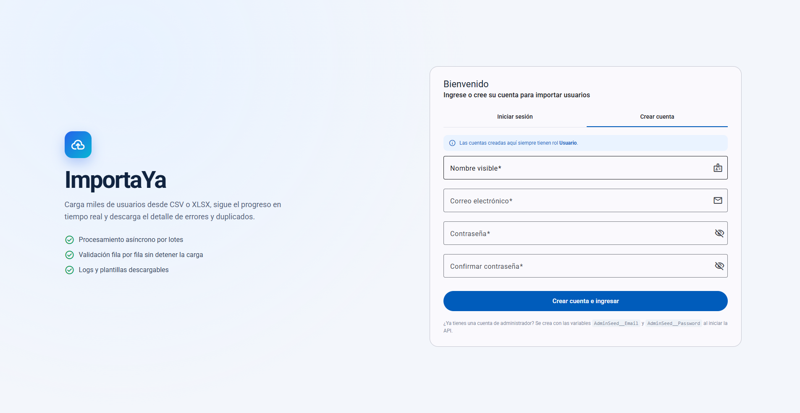
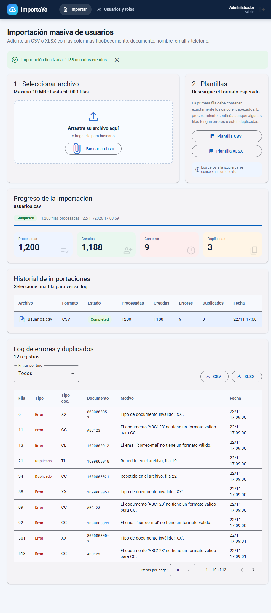
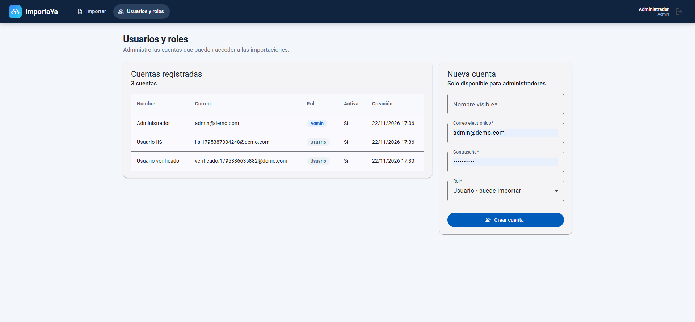
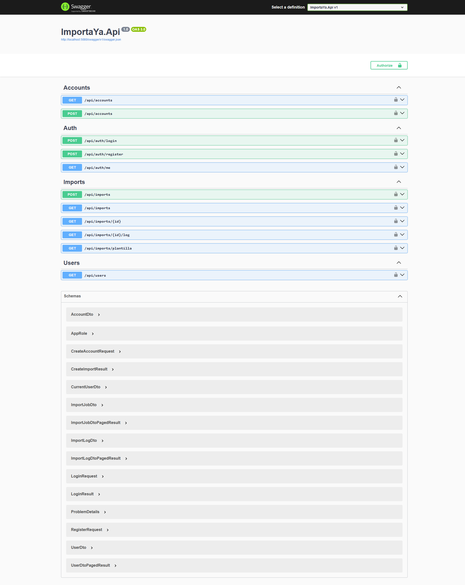

# ImportaYa — importación asíncrona de usuarios

> **Estado: Fases 1, 2 y 4 completadas.** Backend con JWT/roles, API protegida y frontend Angular + Material funcionando de extremo a extremo.
> Pendientes: SignalR (Fase 3), Docker (Fase 5) y Azure DevOps (Fase 6).

**Repositorio:** https://github.com/Csar27/ImportaYa · **Licencia:** MIT ([LICENSE](LICENSE))

## El problema

Cargar miles de usuarios desde un archivo no puede bloquear la petición HTTP. ImportaYa recibe un `.csv` o `.xlsx`, devuelve **202 Accepted** con un id de trabajo en milisegundos y procesa el archivo en segundo plano, registrando cada fila rechazada sin detener la carga.

## Alcance implementado

- **Backend (Fase 1):** API REST, parsers streaming CSV/XLSX detrás de `IFileParser`, validación en español, deduplicación por `(tipoDocumento, documento)` en archivo y base de datos, inserción por lotes con `SqlBulkCopy` (200 filas), TVP para consultar existentes, `BackgroundService` + `Channel<Guid>`, log con filtro/paginación/descarga y plantillas.
- **Seguridad (Fase 2):** cuentas persistentes (`Accounts`), roles `Admin`/`Usuario`, contraseñas con PBKDF2, JWT HS256, seeder de administrador por variables de entorno, registro público que siempre crea `Usuario`, endpoints `/api/auth/*` y `/api/accounts`, y autorización en todos los endpoints de importación. CORS restringido a los orígenes del frontend.
- **Frontend (Fase 4):** Angular 21 standalone + Angular Material, login, shell con navegación según rol, carga por arrastrar y soltar, progreso por sondeo del endpoint de estado, contadores, historial, log filtrable y descargas, y administración de cuentas.

## Arquitectura



Capas: **Domain** no depende de nada; **Application** define los puertos (`IFileParser`, `IFileStorage`, `IUserBulkWriter`, `IImportQueue`, `IImportProgressReporter`, `IPasswordHasher`, `ITokenService`); **Infrastructure** implementa parsers, EF Core, SqlBulkCopy, seguridad, almacenamiento y el worker; **Api** expone HTTP. Las dependencias apuntan siempre hacia adentro.

### Flujo de una carga



### Flujo de autenticación



## Decisiones de diseño

| Decisión | Por qué |
| --- | --- |
| `IAsyncEnumerable<RawUserRow>` en los parsers | El archivo se recorre en flujo; nunca se carga completo en memoria. `RawUserRow` incluye la fila física para que los logs coincidan con lo que ve el usuario (encabezado = fila 1). |
| Parser propio para Excel | `ExcelDataReader` en modo `CreateReader` (sin `AsDataSet`) y conversión explícita de celdas a texto: conserva ceros a la izquierda y evita notación científica. |
| `HashSet` + TVP | Los duplicados dentro del archivo se resuelven en memoria; los de base de datos se consultan de a 200 claves con un `DocumentKeyList` TVP que usa el índice único. Nunca un `SELECT` por fila. |
| `SqlBulkCopy` fuera del `DbContext` | Inserciones rápidas por lote; EF Core queda para jobs, logs, cuentas y consultas. |
| Errores no fatales | Una fila inválida o duplicada se registra y el proceso continúa. |
| `Channel<Guid>` | Respuesta inmediata y un único consumidor; el id del job viaja por la cola y el archivo ya está persistido. |
| Progreso persistido + puerto no-op | El frontend consulta el estado por HTTP; `IImportProgressReporter` ya está preparado para SignalR (Fase 3) sin tocar `ImportProcessor`. |
| Seguridad propia sobre Identity | Se reutiliza `PasswordHasher<Account>` de `Microsoft.Extensions.Identity.Core` para obtener hashes PBKDF2 compatibles, sin acoplar Domain/Application a ASP.NET Core Identity ni arrastrar sus tablas. |
| Rol como enum convertido a texto | `Admin`/`Usuario` se almacenan como texto legible y se emiten como claim de rol en el JWT; las políticas `ImportAllowed` y `AdminOnly` viven en la API. |
| Clave JWT fuera del repositorio | `appsettings.Development.json` contiene solo una clave de desarrollo claramente identificada; en producción la API exige `Jwt__Key` (≥32 caracteres). |
| LocalDB en tests | Docker no estaba disponible en el entorno de desarrollo; se usa SQL Server real (LocalDB) porque `SqlBulkCopy` y los TVP requieren SQL Server, no SQLite. |
| Angular 21 (no 22) | La versión 22.3 requiere Node ≥24.15; el entorno tiene Node 24.11, así se usa la última rama 21 compatible y estable. |

## Estructura

```text
src/
  ImportaYa.Domain/          entidades (User, ImportJob, ImportLog, Account), enums, reglas puras
  ImportaYa.Application/     casos de uso, DTOs, validador, puertos, opciones JWT
  ImportaYa.Infrastructure/  parsers, EF Core, TVP/BulkCopy, worker, storage, seguridad
  ImportaYa.Api/             controllers, CORS, JWT, middleware, appsettings
frontend/                    Angular 21 standalone + Material (login, imports, accounts)
tests/
  ImportaYa.Domain.Tests/
  ImportaYa.Application.Tests/
  ImportaYa.Infrastructure.Tests/
  ImportaYa.IntegrationTests/   WebApplicationFactory + LocalDB + JWT
tools/
  ImportaYa.SampleGenerator/    genera samples/usuarios.csv y .xlsx
samples/                       1.200 filas con errores deliberados
docs/screenshots/              capturas reales de Swagger y del frontend
```

## Requisitos previos

- .NET 8 SDK (también compila con SDK 10).
- SQL Server LocalDB `(localdb)\mssqllocaldb` o cualquier SQL Server accesible.
- Node.js ≥ 20.19 (se usó 24.11) y npm para el frontend.
- No hay secretos en el repositorio: la cadena de conexión por defecto es local y todo lo sensible se sobrescribe por variables de entorno.

## Configuración

| Variable de entorno | Valor por defecto | Descripción |
| --- | --- | --- |
| `ConnectionStrings__Default` | LocalDB `ImportaYa` | Cadena de conexión a SQL Server. |
| `ImportOptions__MaxFileSizeBytes` | `10485760` (10 MB) | Tamaño máximo del archivo. |
| `ImportOptions__MaxRows` | `50000` | Límite de filas procesadas. |
| `ImportOptions__BatchSize` | `200` | Filas por lote de inserción/log. |
| `ImportOptions__StoragePath` | `App_Data/imports` | Directorio de archivos subidos (relativo al binario). |
| `Jwt__Key` | solo en Development | Secreto HS256; **obligatorio** fuera de Development (≥32 caracteres). |
| `Jwt__Issuer` / `Jwt__Audience` | `ImportaYa` / `ImportaYa.Client` | Valores validados en cada token. |
| `Jwt__ExpiresInMinutes` | `60` | Vigencia del token. |
| `AdminSeed__Email` / `AdminSeed__Password` | vacíos | Si se definen, se crea el administrador inicial al arrancar. |
| `AdminSeed__DisplayName` | `Administrador` | Nombre visible del administrador inicial. |
| `Cors__AllowedOrigins__0` / `__1` | `localhost:4200`, `127.0.0.1:4200` | Orígenes autorizados para el frontend. |

Ejemplo en PowerShell:

```powershell
$env:ConnectionStrings__Default = "Server=localhost;Database=ImportaYa;User Id=sa;Password=TU_PASSWORD;TrustServerCertificate=True"
$env:Jwt__Key = "CAMBIA_ESTA_CLAVE_POR_UNA_SEGURA_DE_AL_MENOS_32_CARACTERES"
$env:AdminSeed__Email = "admin@demo.com"
$env:AdminSeed__Password = "CAMBIA_ESTA_CONTRASENA"
```

> Nunca commitees contraseñas ni claves: usa variables de entorno o un gestor de secretos. Si no defines `AdminSeed__*`, la API arranca pero no habrá cuentas: crea una directamente en la tabla `Accounts` o reinicia con el seeder configurado.

## Ejecutar

API (puerto 5080, Swagger en `/swagger`):

```powershell
dotnet tool restore
dotnet build ImportaYa.slnx -c Release
$env:AdminSeed__Email = "admin@demo.com"
$env:AdminSeed__Password = "Admin12345"
dotnet run --project src/ImportaYa.Api
```

Frontend (puerto 4200):

```powershell
cd frontend
npm ci
npm start
```

Abra `http://localhost:4200`, inicie sesión con el administrador sembrado o cree una cuenta desde la pestaña **Crear cuenta** (siempre rol `Usuario`) y suba `samples/usuarios.csv` o `samples/usuarios.xlsx`. Las migraciones se aplican automáticamente al arrancar la API.

> **Configuración de la URL de la API:** el frontend la lee en runtime de `frontend/public/config.json` (no hace falta recompilar; recarga la página tras editarlo):
>
> ```json
> { "apiUrl": "http://localhost:5080/api" }
> ```
>
> | Perfil de la API | Valor de `apiUrl` |
> | --- | --- |
> | **http** (`dotnet run --project src/ImportaYa.Api --launch-profile http`) | `http://localhost:5080/api` |
> | **IIS Express** (Visual Studio) | `https://localhost:44343/api` |
> | HTTP de IIS Express | `http://localhost:39875/api` |
>
> El puerto `44343` de IIS Express es **HTTPS**: llamarlo con `http://` produce `0 Unknown Error`. Si IIS Express está detenido, ese puerto desaparece y también falla. Un `401` en `/api/auth/login` significa credenciales incorrectas o cuenta inexistente; no es un problema de CORS.

## Probar

```powershell
dotnet test ImportaYa.slnx -c Release
cd frontend
npm test -- --watch=false
```

Backend: **22 de dominio + 15 de aplicación + 14 de infraestructura + 14 de integración = 65 pruebas**.
Frontend: **4 pruebas** (componente raíz y servicio de autenticación).

Las pruebas de integración crean una base de datos LocalDB con nombre aleatorio, siembran el administrador y dos duplicados contra BD, limpian las tablas de importación antes de cada test y eliminan la base al terminar. Incluyen login sin autorización (401), creación de cuenta por Admin, acceso denegado a `Usuario` (403) y las cargas reales de 1.200 filas.

## Regenerar los archivos de ejemplo

```powershell
dotnet run --project tools/ImportaYa.SampleGenerator -- samples
```

Cada archivo tiene 1.200 registros (filas 2 a 1201), con:

- 9 errores (3 tipos inválidos, 3 documentos mal formados y 3 emails inválidos).
- 3 duplicados dentro del archivo + 2 duplicados sembrados en BD por el test de integración.
- 1 documento con ceros a la izquierda (`0001234567`) para validar el parser de Excel.

Counters esperados al importar cualquier ejemplo en el test de integración (con los duplicados sembrados):

```text
procesadas = 1200, creadas = 1186, con error = 9, duplicadas = 5
```

En una base de datos vacía los duplicados contra BD no existen, por lo que se esperan `creadas = 1188, duplicadas = 3`.

## Endpoints

Todas las rutas salvo `POST /api/auth/login` y `POST /api/auth/register` requieren `Authorization: Bearer <token>`.

| Método | Ruta | Roles | Descripción |
| --- | --- | --- | --- |
| `POST` | `/api/auth/login` | público | Devuelve `{ token, expiresAt, email, displayName, role }`. |
| `POST` | `/api/auth/register` | público | Crea una cuenta con rol fijo `Usuario` (nunca Admin) y devuelve la cuenta creada. |
| `GET` | `/api/auth/me` | Admin, Usuario | Claims del usuario autenticado. |
| `GET` | `/api/accounts` | Admin | Lista de cuentas. |
| `POST` | `/api/accounts` | Admin | Crea una cuenta con email, contraseña (≥8), nombre y rol. |
| `POST` | `/api/imports` | Admin, Usuario | Sube `file` (`.csv`/`.xlsx`) y devuelve `202` con `{ jobId, status }`. |
| `GET` | `/api/imports` | Admin, Usuario | Historial paginado (`page`, `pageSize`). |
| `GET` | `/api/imports/{id}` | Admin, Usuario | Estado y contadores del trabajo. |
| `GET` | `/api/imports/{id}/log` | Admin, Usuario | Log paginado; `tipo=Error|Duplicado`; `formato=csv|xlsx` descarga el log. |
| `GET` | `/api/imports/plantilla?formato=csv\|xlsx` | Admin, Usuario | Descarga la plantilla con el encabezado exacto. |

Formato del archivo (primera fila = encabezado):

```csv
tipoDocumento,documento,nombre,email,telefono
CC,1045678901,Ana Pérez,ana@demo.com,3001234567
```

Tipos admitidos: `CC`, `CE`, `TI`, `PAS`, `NIT`. `CC`/`CE`/`TI` y `NIT` son numéricos (el NIT admite guion opcional); `PAS` es alfanumérico. Se aceptan comas o punto y coma como separador en CSV, con codificación UTF-8.

## Capturas









## Próximas fases

1. Fase 3 — SignalR para progreso en tiempo real (sin cambiar `ImportProcessor`).
2. Fase 5 — Docker y docker-compose.
3. Fase 6 — Pipeline de Azure DevOps y cierre de documentación.
